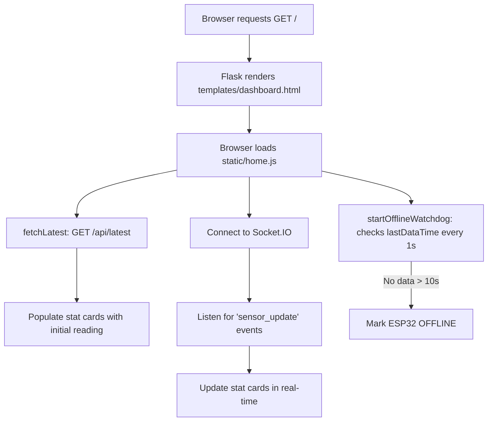

# Route Documentation: `GET /`

## 📋 Overview
- **Endpoint:** `/`
- **Method:** `GET`
- **Controller:** [`app.index()`](file:///D:/aquaalert/server/app.py)
- **Template:** [`templates/dashboard.html`](file:///D:/aquaalert/templates/dashboard.html)
- **Client Script:** [`static/home.js`](file:///D:/aquaalert/static/home.js)

---

## 🎯 Purpose
Serves the lightweight **AquaAlert Home Overview** page. It displays key status indicators, live water percentage, drain distance, system alerts, and device online/offline status without rendering heavy charts.

---

## 🔄 Dataflow



1. Browser navigates to `http://localhost:5000/`.
2. Flask renders [`templates/dashboard.html`](file:///D:/aquaalert/templates/dashboard.html).
3. [`static/home.js`](file:///D:/aquaalert/static/home.js) executes on `DOMContentLoaded`:
   - Calls `GET /api/latest` to seed initial values immediately.
   - Connects to Socket.IO and listens for `"sensor_update"` broadcasts.
   - Starts the client-side offline watchdog timer (10-second timeout).

---

## 💻 Example Request & Response

### Request
```bash
curl -i http://localhost:5000/
```

### Response
- **Status:** `200 OK`
- **Content-Type:** `text/html; charset=utf-8`
- **Body:** Rendered HTML for the home page.
