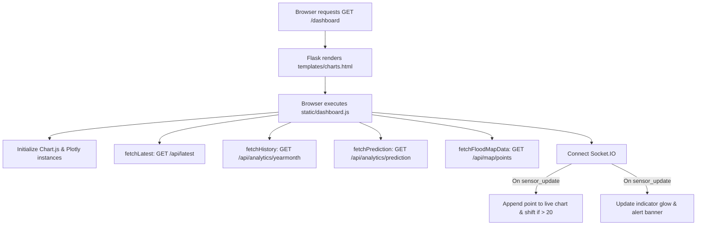

# Route Documentation: `GET /dashboard`

## 📋 Overview
- **Endpoint:** `/dashboard`
- **Method:** `GET`
- **Controller:** [`app.dashboard()`](file:///D:/aquaalert/server/app.py)
- **Template:** [`templates/charts.html`](file:///D:/aquaalert/templates/charts.html)
- **Client Script:** [`static/dashboard.js`](file:///D:/aquaalert/static/dashboard.js)

---

## 🎯 Purpose
Serves the full **Real-Time Interactive Dashboard** featuring:
1. **Live Water Level Line Chart:** 20-point moving window with colored background safety zones.
2. **Month-Wise Seasonal Trend Chart:** Bar and line comparisons with forecast points.
3. **India Flood Risk Map:** Plotly OpenStreetMap visualization of geospatial historical flood incidents.
4. **Status Indicator Grid:** Glowing indicators for `NORMAL`, `WARNING`, `HIGH`, and `CRITICAL`.

---

## 🔍 Why "Year", "All years", and "Forecast" Controls Exist

```
┌────────────────────────────────────────────────────────┐
│  Year [ All years ▾ ]     Forecast [ Next 4 seasons ▾ ]│
└────────────────────────────────────────────────────────┘
```

### 1. `Year` / `All years` Filter
- **Why it is needed:** The India flood risk dataset covers historical monsoon seasons (June, July, August) across multiple years (2023, 2024, 2025).
- **`All years` (Default):** Displays all recorded monsoon months sequentially across every year (e.g. Jun 2023 → Aug 2023 → Jun 2024 → Aug 2024 → Jun 2025 → Aug 2025). This allows users to see the multi-year flood escalation trend.
- **Specific Year (e.g. `2024`):** Filters the chart to only display that year's 3 monsoon months (Jun, Jul, Aug), allowing focused deep-dive analysis of a single rainy season.

### 2. `Forecast` Horizon Selector
- **Why it is needed:** Floods in India follow an annual cyclical monsoon pattern. Municipalities and emergency teams need advance projections for future monsoon cycles.
- **Options (`6`, `12`, `18`, `24` months):**
  - **`Next 2 seasons` (6 mo):** Forecasts Jun 2026 and Jul 2026.
  - **`Next 4 seasons` (12 mo):** Forecasts Jun 2026, Jul 2026, Aug 2026, and Jun 2027.
  - **`Next 6 seasons` (18 mo):** Forecasts the next 6 upcoming monsoon months.
  - **`Next 8 seasons` (24 mo):** Forecasts the next 8 upcoming monsoon months.
- **How it renders:** The historical bars show past actual data, while dashed orange and red lines show the predicted water level and flood risk percentage for future seasons.

---

## 🌊 Why Do Some Map Points Appear in the Sea / Ocean?

On the **India Flood Risk Map**, several coordinate markers appear in the **Arabian Sea**, the **Bay of Bengal**, and the **Indian Ocean**. 

```
          ▲ North (Himalayas)
         / \
        /   \       ◄ Mainland Peninsular India
       /     \
  🌊  /       \  🌊
Arabian Sea    Bay of Bengal
 (e.g. 68°E)    (e.g. 93°E)
      \       /
       \     /
        \   /
         ▼ South (Indian Ocean / Lakshadweep / Andaman)
```

### 1. Rectangular Bounding Box in the Dataset
- The underlying machine learning dataset ([`Datasets/flood_risk_dataset_india.csv`](file:///D:/aquaalert/Datasets/flood_risk_dataset_india.csv)) was sampled using a rectangular geographic bounding box covering the entire Indian subcontinent region:
  - **Latitude:** $\approx 8.0^\circ\text{ N} \dots 37.0^\circ\text{ N}$
  - **Longitude:** $\approx 68.0^\circ\text{ E} \dots 97.0^\circ\text{ E}$
- Because peninsular India is triangular and narrows towards the south, a simple rectangular bounding box naturally encompasses coordinates over open water (Arabian Sea to the west, Bay of Bengal to the east) that were not filtered out with a complex coastal land polygon mask.

### 2. Island Territories & Exclusive Economic Zones (EEZ)
- India includes remote maritime island groups:
  - **Andaman & Nicobar Islands:** Longitudes $92^\circ\text{E} \dots 94^\circ\text{E}$ in the Bay of Bengal / Andaman Sea (e.g., Lat $8.59^\circ$, Lon $93.69^\circ$).
  - **Lakshadweep Archipelago:** Longitudes $71^\circ\text{E} \dots 74^\circ\text{E}$ in the Arabian Sea.
- These coordinates are legitimate Indian maritime territories that face severe coastal flooding, tidal surges, and monsoonal inundation.

### 3. Coastal Hydrology & Marine Meteorological Buoys
- In real-world flood warning networks, coastal and marine buoys measure:
  - **Storm Surge Height & Water Levels:** Cyclone-induced sea surges that cause saline inundation in low-lying coastal deltas.
  - **Marine Rainfall & River Discharge Outflows:** River discharge measurements where major rivers (Ganges, Brahmaputra, Godavari, Krishna) empty into the sea.

### 4. How the Dashboard Plots Points
- [`server/app.py`](file:///D:/aquaalert/server/app.py) (`/api/map/points`) serves the exact GPS `Latitude` and `Longitude` from the CSV without modifying geographic coordinates.
- [`static/dashboard.js`](file:///D:/aquaalert/static/dashboard.js) uses Plotly's `scattermapbox` with OpenStreetMap vector tiles, which faithfully plots each coordinate at its true geographic location on Earth.

---

## 🔄 Dataflow



1. Client loads `/dashboard` and parses HTML.
2. [`static/dashboard.js`](file:///D:/aquaalert/static/dashboard.js) initializes the `liveChart` and `historyChart` canvases.
3. Multiple parallel asynchronous API calls seed historical, predictive, and geospatial map points.
4. Socket.IO connection receives real-time `"sensor_update"` messages from ESP32 ingestions:
   - Appends `{x: timestamp, y: percentage}` to the live line chart (trims to 20 points).
   - Highlights the active status pill (`NORMAL` / `WARNING` / `HIGH` / `CRITICAL`).
   - Displays animated alert banner for elevated conditions.

---

## 💻 Example Request & Response

### Request
```bash
curl -i http://localhost:5000/dashboard
```

### Response
- **Status:** `200 OK`
- **Content-Type:** `text/html; charset=utf-8`
- **Body:** Rendered HTML for the charts dashboard.
