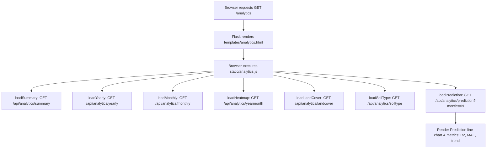

# Route Documentation: `GET /analytics`

## 📋 Overview
- **Endpoint:** `/analytics`
- **Method:** `GET`
- **Controller:** [`app.analytics_page()`](file:///D:/aquaalert/server/app.py)
- **Template:** [`templates/analytics.html`](file:///D:/aquaalert/templates/analytics.html)
- **Client Script:** [`static/analytics.js`](file:///D:/aquaalert/static/analytics.js)

---

## 🎯 Purpose
Serves the **Machine Learning & Historical Analytics** interface. Provides macro insights on the 11,800-record India flood risk dataset (2023–2025), including:
- Summary KPI cards
- Scikit-learn Linear Regression future water level & risk predictions
- Year-wise & Month-wise trend charts and sanitized data tables
- Year × Month risk heatmap matrix
- Land cover & Soil type breakdown doughnut charts

---

## 🔍 Understanding "Year", "All years", and "Forecast" in Analytics

### 1. `Year` vs `All years` in Macro Analytics
- **Year-wise Aggregation (`/api/analytics/yearly`):** Groups the 11,800+ dataset rows by year (2023, 2024, 2025) to calculate annual flood incidence rate, average water level, average rainfall, and river discharge.
- **Year × Month Matrix (`/api/analytics/yearmonth`):** Cross-references each specific year against its monsoon months (e.g. `2023-06`, `2023-07`, `2023-08`) to generate the multi-year flood risk heatmap.

### 2. `Forecast` (Predictive Horizon)
- **Why it is used:** Linear Regression models are trained on all historical seasonal months. The forecast selector (`predict-months` dropdown) configures how many upcoming monsoon periods the ML model predicts.
- **Calculation:**
  $$\text{Seasonal Forecast Points} = \left\lceil \frac{\text{months}}{3} \right\rceil$$
  - `6 months` $\to 2$ seasonal prediction points
  - `12 months` $\to 4$ seasonal prediction points
  - `18 months` $\to 6$ seasonal prediction points
  - `24 months` $\to 8$ seasonal prediction points
- **Output:** Outputs projected water levels ($m$), expected rainfall ($mm$), flood risk probability ($\%$) and derived severity category (`NORMAL`, `WARNING`, `HIGH`, `CRITICAL`).

---

## 🔄 Dataflow



1. On load, [`static/analytics.js`](file:///D:/aquaalert/static/analytics.js) issues parallel `fetch()` requests to all `/api/analytics/*` sub-routes.
2. The user can adjust the forecast horizon (6, 12, 18, or 24 months), which re-queries the backend linear regression engine in [`server/analytics.py`](file:///D:/aquaalert/server/analytics.py).
3. All table cells and labels pass through `escapeHtml()` to eliminate XSS vulnerabilities.

---

## 💻 Example Request & Response

### Request
```bash
curl -i http://localhost:5000/analytics
```

### Response
- **Status:** `200 OK`
- **Content-Type:** `text/html; charset=utf-8`
- **Body:** Rendered HTML for the analytics page.
