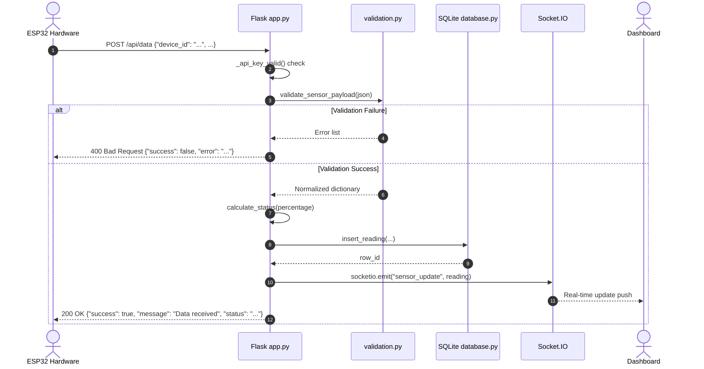

# Route Documentation: `POST /api/data` & `GET /api/data`

## 📋 Overview
- **Endpoint:** `/api/data`
- **Methods:** `POST`, `GET`
- **Controllers:** [`app.receive_data()`](file:///D:/aquaalert/server/app.py) (`POST`), [`app.data_info()`](file:///D:/aquaalert/server/app.py) (`GET`)
- **Authentication:** Optional `X-API-Key` header (if configured on server)

---

## 🎯 Purpose
- **`POST`:** Core sensor ingestion gateway where the ESP32 posts real-time ultrasonic water level measurements. Validates, persists into SQLite, and broadcasts via Socket.IO.
- **`GET`:** Developer-friendly informational endpoint that explains the route expects a POST request and returns example payload schemas instead of a blank 404/405 HTML page.

---

## 🔄 Dataflow for `POST /api/data`



---

## 📥 Request Specifications

### `POST /api/data` Request
- **Headers:**
  - `Content-Type: application/json`
  - `X-API-Key: <key>` *(Optional)*
- **Body Schema:**
```json
{
  "device_id": "AQUA-001",
  "distance": 28.5,
  "waterLevel": 71.5,
  "percentage": 72,
  "status": "HIGH"
}
```

| Field | Type | Range / Format | Description |
|---|---|---|---|
| `device_id` | String | 1–32 alphanumeric (`_`, `-`) | Unique hardware identifier |
| `distance` | Float | $0.0 \dots 450.0\text{ cm}$ | Measured air gap from sensor |
| `waterLevel` | Float | $0.0 \dots 100.0\text{ cm}$ | Calculated water height in drain |
| `percentage` | Integer | $0 \dots 100$ | Capacity percentage |
| `status` | String | `NORMAL`, `WARNING`, `HIGH`, `CRITICAL` | Firmware status tag (verified server-side) |

---

## 📤 Response Specifications

### Success Response (`200 OK`)
```json
{
  "message": "Data received",
  "status": "HIGH",
  "success": true
}
```

### Invalid Payload Response (`400 Bad Request`)
```json
{
  "error": "distance must be between 0 and 450; percentage must be an integer between 0 and 100",
  "success": false
}
```

### Browser GET Visit (`405 Method Not Allowed`)
```json
{
  "error": "This endpoint only accepts POST requests with a JSON sensor payload",
  "example_payload": {
    "device_id": "AQUA-001",
    "distance": 50.0,
    "percentage": 50,
    "status": "WARNING",
    "waterLevel": 50.0
  }
}
```

---

## 💻 Example Testing Commands

### Successful POST:
```bash
curl -X POST http://localhost:5000/api/data \
  -H "Content-Type: application/json" \
  -d '{"device_id":"AQUA-001","distance":28.0,"waterLevel":72.0,"percentage":72,"status":"HIGH"}'
```

### Browser GET Check:
```bash
curl -i http://localhost:5000/api/data
```
