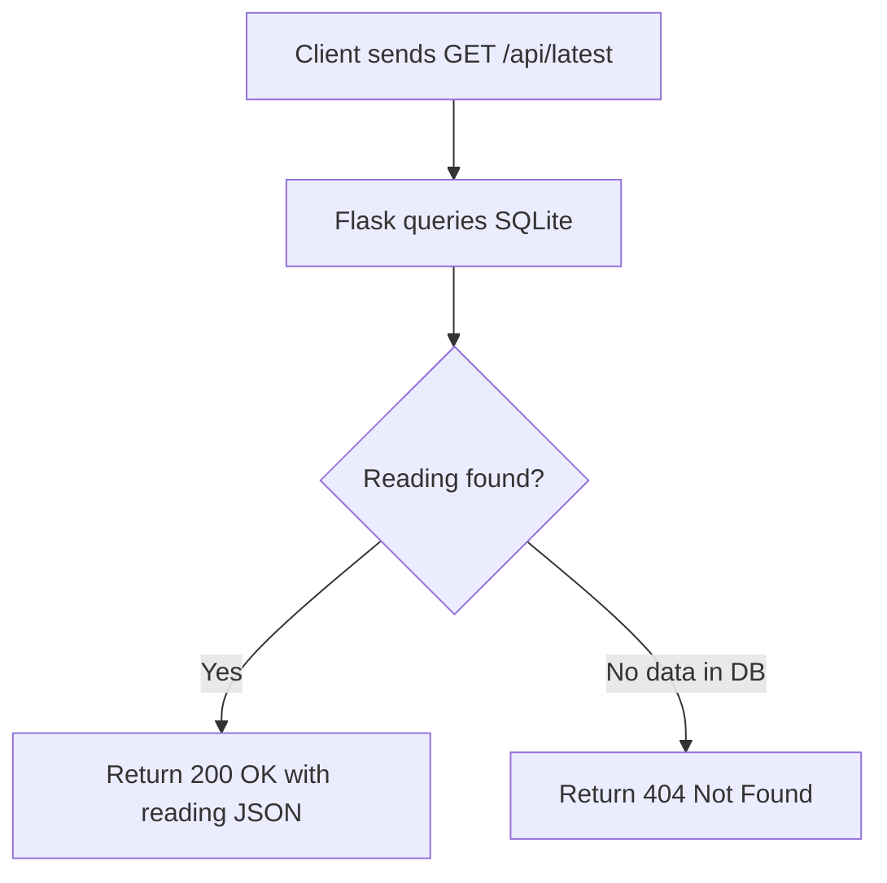

# Route Documentation: `GET /api/latest`

## 📋 Overview
- **Endpoint:** `/api/latest`
- **Method:** `GET`
- **Controller:** [`app.get_latest()`](file:///D:/aquaalert/server/app.py)
- **Database Query:** `SELECT * FROM readings ORDER BY id DESC LIMIT 1`

---

## 🎯 Purpose
Returns the single most recent sensor reading ingested by the system. Used by the web dashboard and mobile clients to initialize displays immediately upon page load before WebSocket updates arrive.

---

## 🔄 Dataflow



---

## 📤 Response Schema

### `200 OK` (Reading Found)
```json
{
  "id": 108,
  "device_id": "AQUA-001",
  "distance": 28.0,
  "water_level": 72.0,
  "percentage": 72,
  "status": "HIGH",
  "timestamp": "2026-08-29 14:36:55"
}
```

### `404 Not Found` (No Readings Ingested Yet)
```json
{
  "message": "No data available"
}
```

---

## 💻 Example Request
```bash
curl -i http://localhost:5000/api/latest
```
