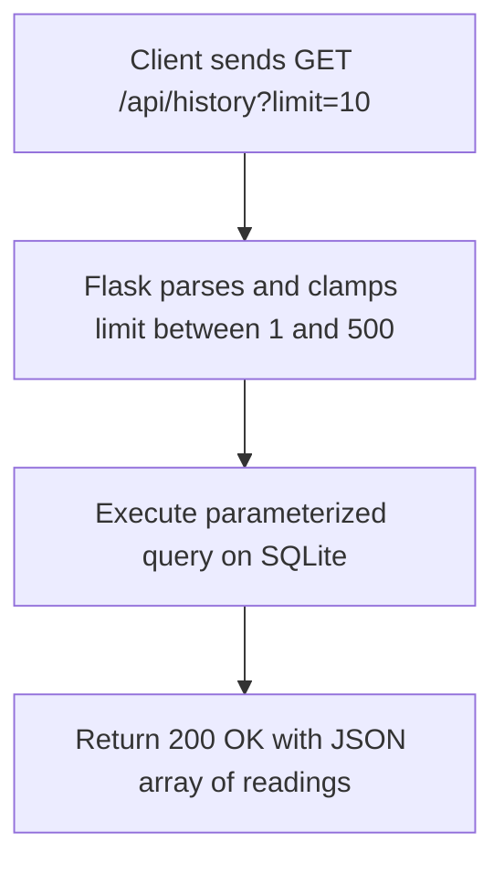

# Route Documentation: `GET /api/history`

## 📋 Overview
- **Endpoint:** `/api/history`
- **Method:** `GET`
- **Controller:** [`app.get_history()`](file:///D:/aquaalert/server/app.py)
- **Query Parameter:** `limit` (optional, default: `50`, range: `1`–`500`)
- **Database Query:** `SELECT * FROM readings ORDER BY id DESC LIMIT ?`

---

## 🎯 Purpose
Returns the last $N$ sensor telemetry readings sorted newest first. Enables chart rendering, telemetry logging, and historical export for trend inspection.

---

## 🔄 Dataflow



---

## 📤 Response Schema (`200 OK`)

```json
[
  {
    "id": 108,
    "device_id": "AQUA-001",
    "distance": 28.0,
    "percentage": 72,
    "status": "HIGH",
    "timestamp": "2026-08-29 14:36:55",
    "water_level": 72.0
  },
  {
    "id": 107,
    "device_id": "AQUA-001",
    "distance": 0.0,
    "percentage": 100,
    "status": "CRITICAL",
    "timestamp": "2026-08-29 14:26:43",
    "water_level": 100.0
  }
]
```

---

## 💻 Example Request
```bash
curl -i "http://localhost:5000/api/history?limit=5"
```
