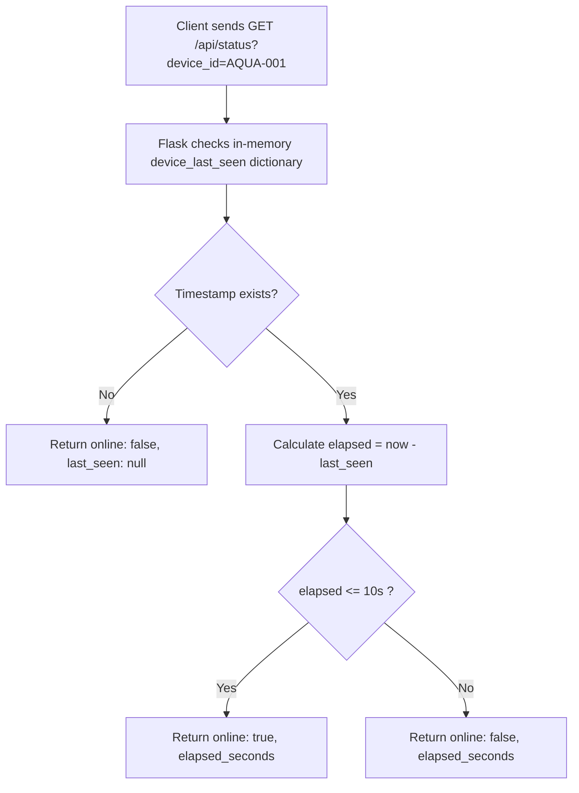

# Route Documentation: `GET /api/status`

## 📋 Overview
- **Endpoint:** `/api/status`
- **Method:** `GET`
- **Controller:** [`app.get_status()`](file:///D:/aquaalert/server/app.py)
- **Query Parameter:** `device_id` (optional, e.g. `?device_id=AQUA-001`)

---

## 🎯 Purpose
Provides a heartbeat / watchdog endpoint that tells clients whether an ESP32 hardware device (or any active sensor node) is **ONLINE** or **OFFLINE**. 

A device is considered **ONLINE** if its last received reading occurred within the last 10 seconds (`OFFLINE_THRESHOLD`).

---

## 🔄 Dataflow



---

## 📤 Response Schema (`200 OK`)

### When Sensor is Active (Online)
```json
{
  "device_id": "AQUA-001",
  "elapsed_seconds": 1.4,
  "last_seen": "2026-08-29T14:36:55.993120+00:00",
  "online": true
}
```

### When Sensor is Inactive (Offline)
```json
{
  "device_id": "AQUA-001",
  "elapsed_seconds": 45.2,
  "last_seen": "2026-08-29T14:36:55.993120+00:00",
  "online": false
}
```

---

## 💻 Example Request
```bash
curl -i "http://localhost:5000/api/status?device_id=AQUA-001"
```
