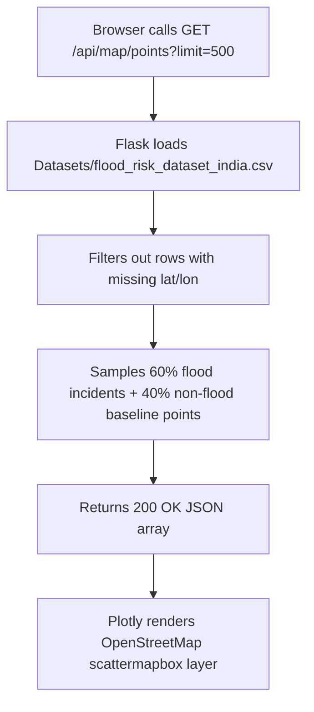

# Route Documentation: `GET /api/map/points`

## 📋 Overview
- **Endpoint:** `/api/map/points`
- **Method:** `GET`
- **Controller:** [`app.api_map_points()`](file:///D:/aquaalert/server/app.py)
- **Query Parameter:** `limit` (optional, default: `500`, range: `1`–`1000`)
- **Data Source:** [`Datasets/flood_risk_dataset_india.csv`](file:///D:/aquaalert/Datasets/flood_risk_dataset_india.csv)

---

## 🎯 Purpose
Provides geospatial flood points sampled across India with GPS coordinates (`Latitude`, `Longitude`), meteorological conditions (`Rainfall (mm)`, `River Discharge (m³/s)`, `Elevation (m)`), and incident records (`Flood Occurred`, `Historical Floods`). 

Powering the interactive Plotly map on `/dashboard`.

> [!NOTE]
> **Why do some points appear in the sea/ocean?**
> The raw CSV was sampled using a rectangular latitude/longitude bounding box ($8^\circ\text{N}\dots 37^\circ\text{N}, 68^\circ\text{E}\dots 97^\circ\text{E}$). Because peninsular India is surrounded by water, points near coastal borders, maritime island territories (Andaman & Nicobar, Lakshadweep), and offshore hydrological buoy coordinates fall in the Arabian Sea and Bay of Bengal. Detailed explanation in [`02_dashboard_page.md`](file:///D:/aquaalert/docs/routes/02_dashboard_page.md).

---

## 🔄 Dataflow



---

## 📤 Response Schema (`200 OK`)

```json
{
  "points": [
    {
      "Elevation (m)": 245.5,
      "Flood Occurred": 1,
      "Historical Floods": 4,
      "Latitude": 26.1445,
      "Longitude": 91.7362,
      "Rainfall (mm)": 185.4,
      "River Discharge (m³/s)": 1420.0,
      "Water Level (m)": 8.42
    },
    {
      "Elevation (m)": 520.1,
      "Flood Occurred": 0,
      "Historical Floods": 0,
      "Latitude": 12.9716,
      "Longitude": 77.5946,
      "Rainfall (mm)": 22.1,
      "River Discharge (m³/s)": 85.0,
      "Water Level (m)": 1.15
    }
  ]
}
```

---

## 💻 Example Request
```bash
curl -i "http://localhost:5000/api/map/points?limit=100"
```
