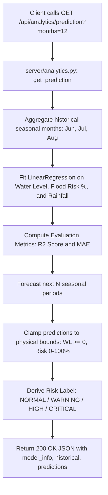

# Route Documentation: `GET /api/analytics/*`

## 📋 Overview
A suite of REST endpoints powered by [`server/analytics.py`](file:///D:/aquaalert/server/analytics.py) and Scikit-Learn that aggregate historical flood metrics and forecast future water level & flood risk.

---

## 🛣️ Endpoints Summary

| Endpoint | Method | Params | Description |
|---|---|---|---|
| `/api/analytics/summary` | `GET` | — | Overall counts, average water level, max rainfall |
| `/api/analytics/yearly` | `GET` | — | Year-by-year monsoon breakdown |
| `/api/analytics/monthly` | `GET` | — | June, July, August seasonal averages |
| `/api/analytics/yearmonth` | `GET` | — | Year × Month risk grid for heatmaps and year filter |
| `/api/analytics/landcover` | `GET` | — | Flood frequency grouped by land type |
| `/api/analytics/soiltype` | `GET` | — | Flood frequency grouped by soil type |
| `/api/analytics/prediction` | `GET` | `months` (6, 12, 18, 24) | Scikit-learn Linear Regression forecasts with $R^2$ & MAE |

---

## 🔍 How `Year`, `All years`, and `Forecast` Work in the API

### 1. `Year` & `YearMonth` Logic (`/api/analytics/yearmonth`)
- **Dataset Context:** The India dataset spans years **2023, 2024, and 2025**.
- **Aggregations:** Grouped by `["Year", "Month"]` for seasonal monsoon months (`06`, `07`, `08`).
- **Client Usage:**
  - When the user selects **`All years`**, the frontend plots every historical `YearMonth` pair sequentially.
  - When the user selects a specific **`Year`** (e.g. `2024`), the frontend filters the returned array for `d.Year === "2024"`.

### 2. `Forecast` Logic (`/api/analytics/prediction?months=N`)
- **Model Training:** Scikit-learn fits ordinary least squares ($y = mx + c$) on past monsoon data points.
- **Horizon Translation:**
  - India monsoons occur 3 months per year (June, July, August).
  - Passing `?months=6` produces $2$ seasonal points.
  - Passing `?months=12` produces $4$ seasonal points.
  - Passing `?months=18` produces $6$ seasonal points.
  - Passing `?months=24` produces $8$ seasonal points.
- **Forecast Generation:** The engine computes the next sequential indices ($n, n+1, \dots$), generates future timestamps (e.g. `2026-06`, `2026-07`), clamps predictions to physically valid ranges, and assigns canonical risk levels (`NORMAL`, `WARNING`, `HIGH`, `CRITICAL`).

---

## 🔬 Machine Learning Prediction Dataflow (`/api/analytics/prediction`)



---

## 📤 Sample Prediction Response (`GET /api/analytics/prediction?months=12`)

```json
{
  "model_info": {
    "forecast_points": 4,
    "fr_mae": 2.145,
    "fr_r2_score": 0.8842,
    "fr_trend_per_month": 0.45,
    "seasonal_months": ["Jun", "Jul", "Aug"],
    "training_months": 9,
    "wl_mae": 0.082,
    "wl_r2_score": 0.9124,
    "wl_trend_per_month": 0.015
  },
  "historical": [
    {
      "actual_wl": 2.45,
      "avg_rainfall": 142.3,
      "fitted_wl": 2.41,
      "flood_risk_pct": 38.5,
      "year_month": "2023-06"
    }
  ],
  "predictions": [
    {
      "month_label": "Jun 2026",
      "predicted_fr": 58.4,
      "predicted_rf": 165.2,
      "predicted_wl": 2.89,
      "risk_label": "WARNING",
      "year_month": "2026-06"
    },
    {
      "month_label": "Jul 2026",
      "predicted_fr": 74.1,
      "predicted_rf": 192.0,
      "predicted_wl": 3.12,
      "risk_label": "HIGH",
      "year_month": "2026-07"
    }
  ]
}
```

---

## 💻 Example Testing Commands
```bash
# 1. Summary KPIs
curl -i http://localhost:5000/api/analytics/summary

# 2. Yearly breakdown
curl -i http://localhost:5000/api/analytics/yearly

# 3. 12-Month Future Prediction
curl -i "http://localhost:5000/api/analytics/prediction?months=12"
```
