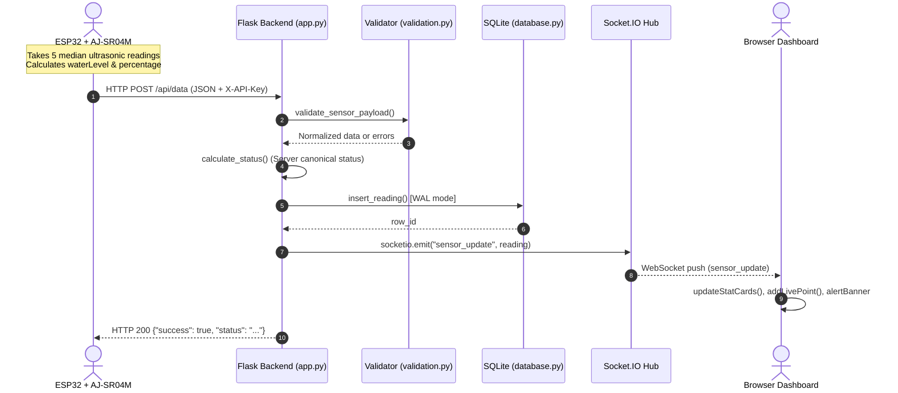

# AquaAlert Route Documentation Index

AquaAlert provides both web UI routes and REST API endpoints for real-time flood monitoring, sensor ingestion, and analytics.

---

## 🗺️ System Route Map

| Category | Method | Endpoint | Description | Documentation |
|---|---|---|---|---|
| **Web UI** | `GET` | `/` | Home status cards | [01_home_page.md](file:///D:/aquaalert/docs/routes/01_home_page.md) |
| **Web UI** | `GET` | `/dashboard` | Live charts & India map | [02_dashboard_page.md](file:///D:/aquaalert/docs/routes/02_dashboard_page.md) |
| **Web UI** | `GET` | `/analytics` | Historical & predictive ML analytics | [03_analytics_page.md](file:///D:/aquaalert/docs/routes/03_analytics_page.md) |
| **Web UI** | `GET` | `/about` | System architecture & spec | [04_about_page.md](file:///D:/aquaalert/docs/routes/04_about_page.md) |
| **Sensor API** | `POST` | `/api/data` | Ingest ESP32 readings | [05_api_data.md](file:///D:/aquaalert/docs/routes/05_api_data.md) |
| **Sensor API** | `GET` | `/api/data` | Endpoint usage documentation | [05_api_data.md](file:///D:/aquaalert/docs/routes/05_api_data.md) |
| **Telemetry API** | `GET` | `/api/latest` | Most recent sensor reading | [06_api_latest.md](file:///D:/aquaalert/docs/routes/06_api_latest.md) |
| **Telemetry API** | `GET` | `/api/history` | Historical readings list | [07_api_history.md](file:///D:/aquaalert/docs/routes/07_api_history.md) |
| **Telemetry API** | `GET` | `/api/status` | ESP32 online/offline watchdog | [08_api_status.md](file:///D:/aquaalert/docs/routes/08_api_status.md) |
| **Geospatial API**| `GET` | `/api/map/points`| Sampled flood map markers | [09_api_map_points.md](file:///D:/aquaalert/docs/routes/09_api_map_points.md) |
| **ML Analytics**  | `GET` | `/api/analytics/*`| Seasonal analysis & forecasting | [10_api_analytics.md](file:///D:/aquaalert/docs/routes/10_api_analytics.md) |

---

## 🔍 Why "Year", "All years", and "Forecast" Exist in the System

AquaAlert has two primary data layers:
1. **Real-time IoT Telemetry:** Live readings every 2 seconds from the ESP32 ultrasonic sensor for instant waterlogging alerts.
2. **Seasonal Monsoon Flood Analytics:** India-wide historical data (2023–2025) and ML forecasting.

Because monsoon flooding in India is seasonal (occurring primarily during June, July, and August):
- **`Year` / `All years`:** Allows switching between a multi-year chronological view (**`All years`** showing long-term climate & risk escalation) and a single-season view (**`2023`**, **`2024`**, or **`2025`** for detailed month-by-month analysis).
- **`Forecast`:** Configures the Scikit-learn Linear Regression model to project ahead by **2, 4, 6, or 8 upcoming monsoon seasons** (6 to 24 calendar months), giving emergency planners advance projections for future rainy seasons.

---

## 🔄 End-to-End System Dataflow

